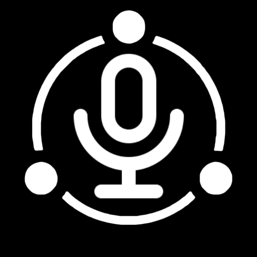
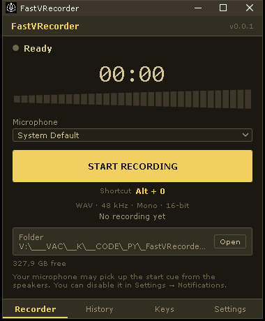
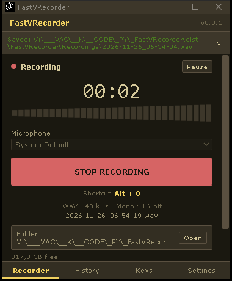
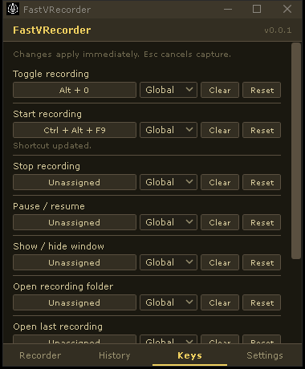
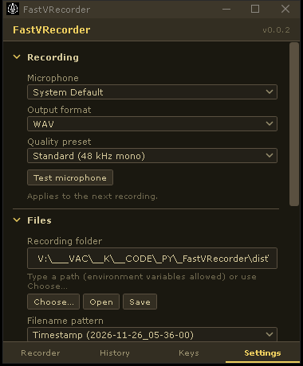

<div align="center">
  

  <h1>FastVRecorder</h1>

  <p><strong>One hotkey. Your voice. Nothing else.</strong></p>
  <p>A compact, portable microphone recorder for Windows.<br>
  Open → Configure → Forget → Record.</p>

  
  
  
  

  <p><a href="https://github.com/vacterro/FastVRecorder/releases"><strong>Releases</strong></a> · <a href="#quick-start">Quick start</a> · <a href="docs/USER_GUIDE.md">User guide</a> · <a href="CHANGELOG.md">Changelog</a></p>
</div>

## A look inside

<div align="center">
  
  
  
  
  <p><sub>Recorder · Live recording · Hotkeys · Settings — Golden Default theme</sub></p>
  <a href="media/screenshots">More screenshots</a>
</div>

## Features

- **Record from anywhere:** press `Alt + 0` to start or stop, even when the app is in the tray.
- **Hear it again:** `Ctrl + Alt + L` opens and plays the last recording in your default player.
- **Your audio, your files:** WAV or MP3 (when the Windows encoder is available), timestamp or incremental names, and a configurable output folder.
- **Built for interruptions:** recoverable partial files, periodic disk checkpoints and long-recording segmentation.
- **Make it yours:** configurable global and local hotkeys, sound cues, microphone selection and optional Windows autostart.
- **One compact window:** recording, history, playback, shortcuts and settings with Wintage themes and 33 UI languages.
- **Portable and private:** local settings, no installer, no required administrator rights, no cloud or telemetry.

## Quick start

1. Get a portable build from [Releases](https://github.com/vacterro/FastVRecorder/releases) when available, or build it from source below.
2. Extract the folder and run `FastVRecorder.exe`.
3. Choose your microphone and recording folder in **Settings**.
4. Press **Alt + 0** to record. Press it again to save. Close the window to keep recording controls available in the tray.

> Default: 48 kHz mono, 16-bit PCM WAV. Use **Settings → Recording → Test microphone** to verify your input signal.

## Build from source

Windows 10/11 x64 and the .NET 10 SDK are required for development.

```powershell
.\scripts\Publish.ps1
```

The self-contained portable build is generated in `dist\FastVRecorder`. No separate .NET runtime installation is required for the published build.

## Documentation

[User guide & troubleshooting](docs/USER_GUIDE.md) · [Architecture](docs/ARCHITECTURE.md) · [Acceptance & testing](docs/ACCEPTANCE.md) · [Roadmap](docs/ROADMAP.md) · [Changelog](CHANGELOG.md)

<div align="center"><sub>FastVRecorder · Simple by design.</sub></div>
