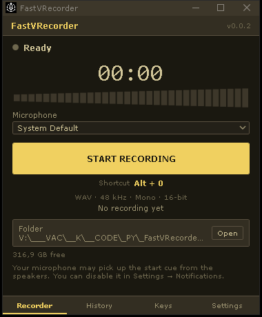
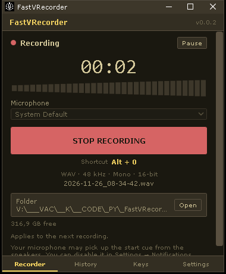
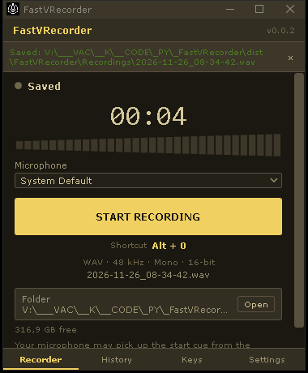
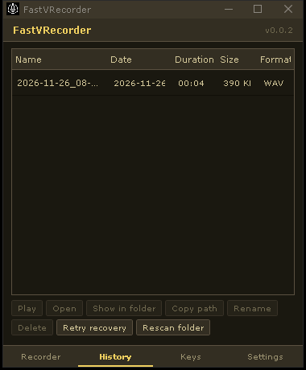
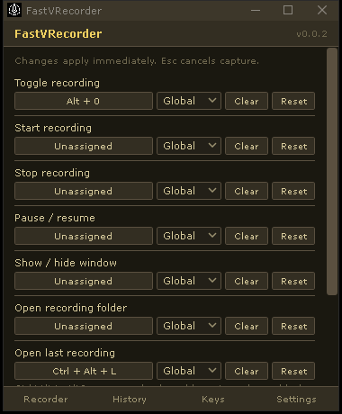
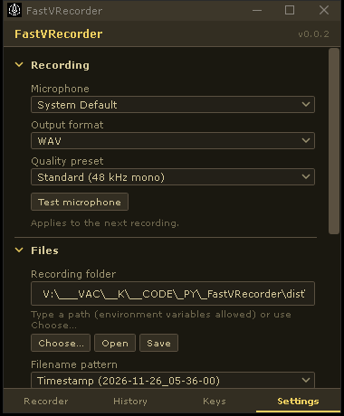
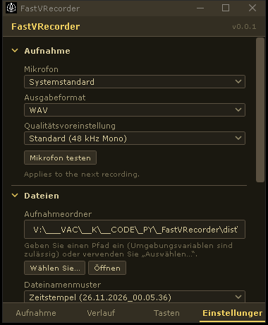
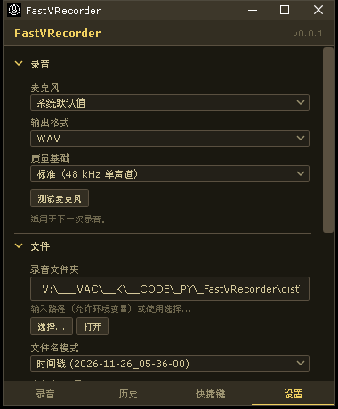
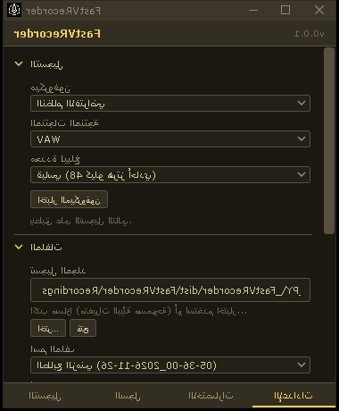

# FastVRecorder 0.0.2 — User and technical guide

[Back to project overview](../README.md)

A compact, portable, crash-safe voice recorder for Windows. One hotkey (`Alt + 0`), a tray icon,
and nothing else to think about.

Open → Configure → Forget → Record.

---

## Quick start

1. Unpack the portable folder and run `FastVRecorder.exe`. No installer, no administrator rights,
   no .NET runtime installation (the published build is self-contained).
2. On first run the recording folder is `<application folder>\Recordings`; change it once in
   **Settings → Files** if you want a different place.
3. Press **Alt + 0** in any normal Windows application. `start.wav` plays and the microphone starts
   recording. Press **Alt + 0** again; the file is finalized, verified, indexed in History, and
   `done.wav` plays.
4. Close or minimize the window; FastVRecorder keeps running in the tray.

The same actions are available from the main button, the tray menu, and the hotkey editor.

## What it is (and is not)

It is a personal, exceptionally reliable voice recorder: WASAPI shared-mode capture, WAV or MP3,
portable settings, crash recovery, one window.

It is not a DAW, OBS, an audio editor, or a recording studio. There is no desktop-audio capture,
no cloud upload, no background service, no database, and no network access.

## Features

### Recording engine
- WASAPI **shared mode** through NAudio's stable `WasapiRecorder`; raw mode is requested so Windows
  audio enhancements (AGC, noise suppression APOs) do not alter the signal, with a fallback to the
  normal shared pipeline when a driver rejects raw mode.
- Default target: **48 kHz, mono, 16-bit PCM WAV**; 24-bit and Float32 WAV are available through the
  Custom quality controls. MP3 (64/96/128/192 kbps) is encoded after the stop through Windows Media
  Foundation and is only offered when the encoder probe succeeds.
- Any device format (float, 16/24/32-bit PCM, mono/stereo/multichannel) is converted correctly:
  float samples are never reinterpreted as integers; channel mapping and resampling happen on the
  writer thread, never inside the audio callback.
- Streaming to disk through a bounded 8-second queue; the audio callback only copies bytes. Queue
  overflow is counted and reported instead of being silently hidden.
- `fsync` checkpoints every **1.5 s** (configurable 0.5–10 s); the header is patched on every
  checkpoint.
- Automatic segment rollover at 2 GiB keeps the RIFF size field valid; hours-long sessions continue
  in a new file instead of corrupting the current one.
- Explicit state machine: `Idle → Starting → Recording → Paused → Stopping → Finalizing → Idle`,
  plus `Recovering` and `Error`; every command is serialized, so fast double presses cannot start
  two recordings, double-dispose the device, or overlap finalization.

### Crash recovery (P0)
- Audio is written to `name.wav.part` with a real WAV header from the first byte, plus
  `name.wav.recovery.json` (format, rate, channels, bits, block align, start time, intended output,
  recording id, schema version).
- On the next launch the app scans the recording folder and its journal
  (`config/active-recordings.json`), rebuilds `<name>_RECOVERED.wav`, verifies the header and reads
  frames back with NAudio, then indexes it in History as **Recovered**.
- The damaged `.part` is never deleted; unreadable parts are kept for diagnosis and marked with a
  `.unrecoverable.json` sidecar. Recovery is idempotent.
- The recovery scan only drops an incomplete trailing sample frame; no silent corruption, no
  invented success.

### File naming and storage
- OBS-like timestamps (`2026-11-26_05-36-00.wav`), persistent counters (`Recording_0001.wav`), or
  `<prefix>_<date>_0001.wav`.
- Collision suffixes (`_001`, `_002`), date folders, sanitized prefix, reserved-device-name guard,
  no path traversal, no overwrite ever.
- Name reservation uses `FileMode.CreateNew` on the `.part` file (atomic), and the final rename uses
  a non-overwriting move; an existing file is never replaced.
- Counter high-water marks are stored atomically in `config/counters.json` and are never reused
  after a failed recording.

### Settings and portability
- `config/settings.json`, camelCase JSON, schema version, atomic write with a
  `settings.json.bak` copy of the previous valid document.
- Missing fields keep their defaults; malformed sections fall back individually; a fully corrupt
  document is preserved as `settings.json.corrupt` and defaults are used.
- Auto-save (no Apply button); import/export/reset in Advanced; read-only portable folders are
  detected and reported instead of silently redirecting settings to AppData.
- Every path is resolved relative to the executable folder, never the process working directory.
  Recording folders inside the portable root are stored relative; moving the folder keeps themes,
  sounds, settings, hotkeys, and the default recording folder working.

### History
- Persistent `config/history.json`, compact table (name, date, duration, size, format).
- Built-in single player (never two at once), open with the default player, reveal in Explorer,
  copy path, inline rename, and delete to the **Recycle Bin** with inline confirmation.
- External deletion/move is detected and shown as **Missing**; recovered and incomplete recordings
  are marked. No age-based automatic deletion.

### Hotkeys
- Native `RegisterHotKey` + `MOD_NOREPEAT` on a message-only window; no keyboard polling, no
  low-level hook, no administrator rights.
- Defaults: `Alt + 0` toggles recording; `Ctrl + Alt + L` opens and plays the last recording in
  the Windows default player. `Numpad 0` is a separate assignable combination.
- Global and local scopes; click-to-assign capture, Esc cancel, Clear, Reset, conflict status.
- Assignments are transactional: Windows registration is attempted first and the previous working
  set is restored if the new combination is rejected. Reserved combinations (Win+L, Alt+Tab, …)
  and typing-blocking global combos are rejected.
- While capturing, global registrations are released so any combination can be entered; a WM_HOTKEY
  can never start a recording during editing.

### Notifications and tray
- Original `media/start.wav`, `done.wav`, `error.wav`; master volume default **35 %**, per-event
  toggles, preview buttons, optional Windows balloon (default OFF).
- **Notification output device** selector, so cues can avoid a microphone's headphone jack when
  Windows uses it as the default output.
- Playback is asynchronous and never blocks capture or the UI; a missing or broken sound is ignored
  and never blocks a recording or recurses the error cue.
- Tray icon variants for idle, recording, paused, and error; menu with start/stop, open folder,
  open last recording, settings, show/hide, exit.
- `done.wav` is played only after the final file is verified and renamed; failures play `error.wav`
  and report the reason.

### Themes and icons
- Wintage theme contract: the original 21 tokens, with **Golden Default** as the default and every
  original theme from the local Wintage collection shipped in `themes/`.
- Semantic brushes (`Background`, `Surface`, `Accent`, `Recording`, `Error`, …) are the only colours
  used by controls; switching the theme updates them live without a restart and remembers the
  choice. Corrupt theme files are skipped with a fallback to Golden Default.
- Multi-resolution `media/favicon.ico` (16–256 px) plus tray variants derived from the original
  `media/favicon.png`; the EXE, window, taskbar, tray, and startup shortcut use the original icon.

### Interface
- One window: Recorder, History, Keys, Settings. Only the system folder picker and Explorer are
  external surfaces.
- Default 380 × 460 DIP, resizable, per-monitor DPI aware (manifest), geometry remembered and
  clamped to the visible desktop.
- Status text, large byte-based timer, live level meter, microphone selector, main button, hotkey,
  format, current/last filename, folder access, free-space indicator.
- **Test microphone** in Settings → Recording with a live level meter, plus an automatic
  "no signal" warning after ~5 s of silent recording.
- **33 UI languages** (native names, Arabic right-to-left), switchable at runtime; theme and
  language are persisted. Language packs are embedded and can be overridden from `languages/`.

## Portable layout

```
FastVRecorder/
├── FastVRecorder.exe
├── config/                 created on first run
│   ├── settings.json
│   ├── settings.json.bak
│   ├── history.json
│   ├── counters.json
│   ├── active-recordings.json
│   └── logs/fastvrecorder.log
├── media/
│   ├── favicon.png / favicon.ico
│   ├── start.wav / done.wav / error.wav
│   └── tray-idle.ico / tray-recording.ico / tray-paused.ico / tray-error.ico
├── languages/              33 UI language packs (overrideable JSON)
├── themes/                 Wintage theme JSON files (overrideable)
└── Recordings/             default output folder
```

## Build, test, publish

Requirements for building: Windows 10/11 x64 and the .NET 10 SDK.

```powershell
scripts\Build.ps1        # restore + build Release
scripts\Test.ps1         # xUnit core + integration tests
scripts\Publish.ps1      # tests, then self-contained win-x64 portable build in dist\FastVRecorder
scripts\Clean-Build.ps1  # remove bin/obj and owned publish staging (dist is preserved)
```

Manual equivalents:

```powershell
dotnet build FastVRecorder.sln -c Release
dotnet test FastVRecorder.sln -c Release
dotnet publish src\FastVRecorder.App\FastVRecorder.App.csproj -c Release -r win-x64 --self-contained true -o dist\FastVRecorder
```

The published folder is portable: no installer, no registry requirement for normal operation, no
.NET runtime download. The only optional registry touch is the HKCU Run fallback used when the
Startup-folder shortcut cannot be created by *Start with Windows*.

## Tests

- `FastVRecorder.Core.Tests` (87 tests): naming/reservation, WAV header/writer/verifier, device
  format conversion and resampling, settings atomicity/backup/corruption/migration, hotkey parsing
  and validation, theme contract, history index, journal.
- `FastVRecorder.Integration.Tests` (36 tests): full engine start/stop with a deterministic fake
  capture device, concurrent start/stop, pause/resume, missing microphone, unavailable folder,
  MP3 when Media Foundation exists, crash recovery from `.part` with and without metadata,
  idempotent recovery, journal-driven discovery, damaged-part handling, cue player failure modes.

Run `scripts\Test.ps1` (123 tests).

## Defaults

| Setting | Value |
|---|---|
| Hotkey (toggle recording) | `Alt + 0` |
| Hotkey (open & play last recording) | `Ctrl + Alt + L` |
| Format | WAV PCM 16-bit |
| Quality preset | Standard (48 kHz, mono) |
| Recording folder | `<app>\Recordings` |
| Filename | `yyyy-MM-dd_HH-mm-ss.wav` |
| Notification volume | 35 % |
| Recovery checkpoint | 1.5 s |
| Low disk threshold | 500 MB |
| Close / minimize to tray | ON |
| Start with Windows | OFF |
| Theme | Golden Default |
| UI language | Auto (Windows) |

## Known limits

- The Windows secure desktop, other user sessions, and applications that deliberately block a
  combination cannot be captured by `RegisterHotKey`; FastVRecorder does not try to bypass them.
- MP3 needs Windows Media Foundation (desktop Windows normally has it). When the probe fails the
  option is hidden and WAV remains available.
- FLAC and Opus are not shipped: they would require an external codec, and the request forbids
  advertising formats that do not work out of the box.
- Recovery can only restore bytes that reached the file system. Data the OS or the drive never
  flushed cannot be invented.
- No waveform editor, pinning/search/filtering is optional and not included in 0.0.2.
- The 31 added language packs are machine-translated from English; every missing key falls back
  to English, and any pack can be corrected in `languages/<code>.json` without rebuilding.
- The full WASAPI path was exercised against a real `ATR2100x-USB` endpoint, including real
  multi-second WAV files and a forced process kill with successful `_RECOVERED.wav` rebuild. An
  earlier build had a ring-buffer write-cursor bug that produced near-silence (about -65 dBFS);
  after the fix the same endpoint produced peak 13925 / RMS 1537 and a verified 3.11 s recording.
  A genuinely quiet input can still look silent; use **Settings → Recording → Test microphone**
  to check the signal before recording.

## Screenshots

All captures live in [media/screenshots](../media/screenshots) (English, German, Chinese, Arabic RTL).

| Recorder | Live recording | Saved | History |
|---|---|---|---|
|  |  |  |  |

| Keys | Settings | German | Chinese | Arabic (RTL) |
|---|---|---|---|---|
|  |  |  |  |  |

Additional captures: hotkey assignment, microphone test, and the original operator screenshots
(`start.png`, `2026-11-26_064442.png`, `clipboard_*.png`).

## Documentation

- [docs/ARCHITECTURE.md](ARCHITECTURE.md) — layers, threading model, recording lifecycle,
  recovery algorithm, theme and hotkey design.
- [docs/ACCEPTANCE.md](ACCEPTANCE.md) — requirement-to-evidence matrix for the handoff.
- [docs/ROADMAP.md](ROADMAP.md) — deliberately deferred work.
- [CHANGELOG.md](../CHANGELOG.md) — release history.
